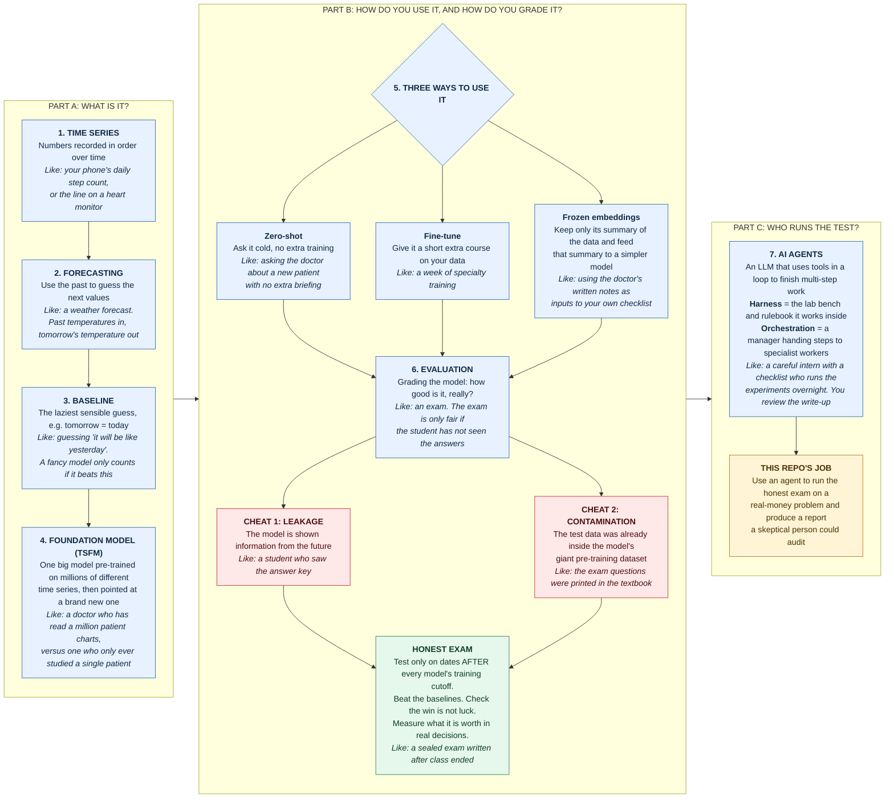
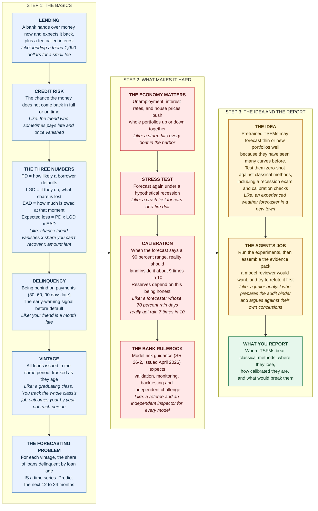
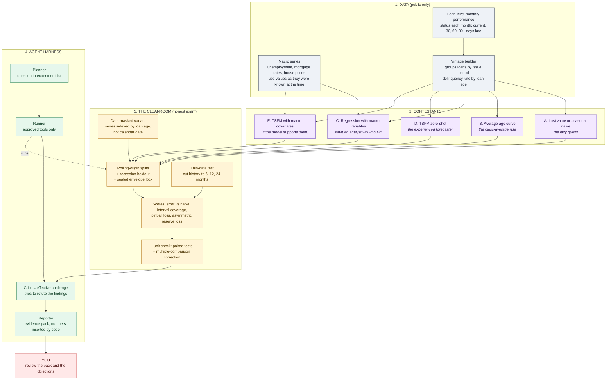

# Reserve: PLAN.md

**In one sentence:** Reserve tests whether time series foundation models can forecast when whole groups of loans start going bad, including during a recession, better than the classical methods lenders use, and it uses an AI agent to assemble the validation package a bank's model reviewers would ask for.

**Why the name:** A "reserve" is the money a lender sets aside because some loans will not be repaid, and a "reserve" is also a wine that has aged well. Loans issued in the same period are called a vintage and age like wine. The project forecasts how each vintage will age, and how much to set aside.

**Role in your portfolio:** Credit risk and underwriting, the second of three fintech projects (the others are Tells for fraud and Culprit for payments). It is the project that uses your Economics minor most directly, because recessions, unemployment, and interest rates drive defaults.

**Prerequisite:** The Cleanroom testing toolkit built in Tells (Days 1 to 11) and released as the git tag `cleanroom-v0.1`. Build that first, or at least its split, lock, metrics, bootstrap, and multiple-comparison modules.

## How to use this document

| If you want to... | Read |
|---|---|
| Understand the field from zero | Part 1 (shared basics) then Part 2 |
| See how the system fits together | Part 3 |
| Explain it to a recruiter or friend | Part 4 |
| Know exactly what to build | Part 5 |
| Know what to do each day | Part 6 |
| Stay honest about limits | Part 7 |
| Check where claims come from | Part 8 |

**Diagram images:** every diagram in this file also exists as a PNG in the `diagrams/` folder next to it, with editable Mermaid source in `diagrams/source/`.

---

## Part 1. Start here: the basics, from zero

You do not need any finance or machine learning background to follow this part. Read the diagrams top to bottom. Every box has a plain definition and a real-world analogy.

### Diagram 1. The ladder of ideas (what a "time series foundation model" is, and why testing it honestly is hard)

### Diagram 2. The Cleanroom: how we keep the exam honest

The Cleanroom is the shared testing toolkit every project in this folder uses. The idea is simple: make cheating mechanically impossible, so the results are believable.

```mermaid
flowchart LR
    R["<b>Raw data</b><br/>events with timestamps<br/><i>Like: a long ledger,<br/>oldest entry first</i>"]
    S["<b>Time split</b><br/>Train on the past.<br/>Leave a gap.<br/>Test only on the future<br/><i>Like: study the textbook,<br/>then sit the exam next term</i>"]
    L["<b>Sealed envelope</b><br/>Lock the test plan and a hash of it<br/>BEFORE looking at any score<br/><i>Like: pre-registering a<br/>science experiment</i>"]
    M["<b>Contestants</b><br/>1. Lazy baseline<br/>2. Strong classic model<br/>3. TSFM zero-shot<br/>4. TSFM + classic model<br/><i>Like: a race with a<br/>walker as the control</i>"]
    P["<b>Contamination probe</b><br/>Does the model do suspiciously<br/>better on dates it may have seen?<br/><i>Like: checking if the student<br/>aced only the old questions</i>"]
    T["<b>Is it luck?</b><br/>Statistical tests + multiple-comparison correction<br/><i>Like: a coin that lands heads<br/>3 times is not magic</i>"]
    D["<b>What is it worth?</b><br/>Money-style metric for the domain<br/><i>Like: not 'how accurate',<br/>but 'how many dollars saved'</i>"]
    O["<b>Audit-ready report</b><br/>Numbers, plots, caveats,<br/>and what was NOT tested"]

    R --> S --> L --> M --> P --> T --> D --> O

    classDef step fill:#e8f1ff,stroke:#2b6cb0,color:#102a43;
    classDef lock fill:#fff4d6,stroke:#b7791f,color:#4a3200;
    classDef out fill:#e6f7ec,stroke:#2f855a,color:#0f3d24;
    class R,S,M,P,T,D step;
    class L lock;
    class O out;
```

### Glossary (plain English)

| Term | What it means | Everyday analogy |
|---|---|---|
| Time series | Measurements in time order | A diary of daily step counts |
| Forecast | A guess about future values | Tomorrow's weather |
| Horizon | How far ahead you guess (1 day, 22 days) | "Weather for tomorrow" vs "weather next month" |
| Baseline | The simplest reasonable guess you must beat | "Tomorrow will be like today" |
| Foundation model | A big model pre-trained once on huge, varied data, reused for many tasks | A doctor with a million charts of experience |
| TSFM | A foundation model for time series (examples: Chronos-2, TimesFM, Moirai, TiRex, TTM) | The same doctor, but for numbers over time |
| Zero-shot | Using a model with no extra training on your data | Asking a new patient's question cold |
| Fine-tuning | Brief extra training on your data | Specialty course |
| Embedding | A short list of numbers that summarizes something (here, an account's history) | A fingerprint or a one-line summary of a person |
| Pre-training cutoff | The last date of data a model learned from | The day the textbook was printed |
| Leakage | Future information sneaking into training or testing | Seeing the answer key |
| Contamination | Test data already inside the pre-training data | Exam questions in the textbook |
| Out-of-sample | Data the model never touched while being built | The real exam |
| Calibration | When it says "10% chance", it happens about 10% of the time | A forecaster who says 70% rain and it rains 7 days in 10 |
| Precision / recall | Of the alarms, how many were real / of the real cases, how many did we catch | A smoke alarm: false alarms vs missed fires |
| PR-AUC | One number summarizing precision vs recall when real cases are rare | A report card for a smoke alarm that rarely goes off |
| Statistical test (Diebold-Mariano) | Checks whether one forecaster's win over another is bigger than luck | Is the better free-throw shooter actually better, or just had a good night? |
| Multiple-comparison correction | If you test many ideas, some will look good by chance, so you raise the bar | Buy 100 lottery tickets and one will look like talent |
| Agent | An LLM that picks tools and acts in a loop | An intern who can run experiments |
| Harness | The tools, permissions and rules wrapped around an agent | The lab bench and safety rulebook |
| Orchestration | Coordinating several agent steps or workers | A project manager |
| Pre-registration | Writing down the test plan before seeing results | Sealing the exam rubric in an envelope |

### What the research says, in one honest paragraph

Time series foundation models are not magic for predicting stock returns. In one study, zero-shot Chronos got an out-of-sample R-squared of about -1.37 percent and TimesFM about -2.80 percent on daily returns, which means worse than simply predicting zero ([Re(Visiting) TSFMs in Finance](https://arxiv.org/html/2511.18578v1)). Another found pretrained models beat a random walk with statistical significance in only two asset-model pairs ([Pretrained TSFMs for Financial Return Forecasting](https://arxiv.org/html/2606.27100)). For realized volatility, only one model, TTM, beat the standard econometric benchmark, by roughly 1.3 to 1.8 percent ([Realized volatility with TSFMs](https://arxiv.org/html/2607.05291v1)). Meanwhile, evaluating these models fairly is itself unsolved: a lineage study of 22 TSFMs found only 6 percent of 401 datasets never appeared in any model's pre-training, and leaking just 0.1 percent of held-out data improved error by 8 to 29 points ([TSFM benchmarking challenges](https://arxiv.org/pdf/2510.13654v3)). The live, pre-registered leaderboard that would fix this (TS-Arena) covers energy only so far ([TS-Arena](https://arxiv.org/html/2512.20761v1)). So the opportunity is not "TSFMs beat the market." It is "TSFMs may be useful as feature extractors in risk problems, and almost nobody tests that honestly." That is what these projects do.

---

## Part 2. Credit risk, from zero

### Diagram 3. What credit risk is and where a TSFM could help

**A walk-through in plain words.** A bank that makes thousands of loans cannot watch each borrower. It watches groups. It asks: of the loans we made in early 2019, what share is behind on payments after 6 months, 12 months, 24 months? That curve is a time series. If you can forecast it, you know how much money to set aside and whether to tighten lending.

The hard parts are: a new loan product has almost no history, the economy can change the whole curve overnight, and regulators want evidence that the forecasting model was validated independently. Reserve tests whether pretrained time series models help with the first two, and whether an agent can automate part of the third.

**Real-world analogy for the whole project.** A school wants to know how each year's incoming class will fare over four years. It has records for old classes, but a new program has only one semester of data. Reserve asks whether a forecaster who has studied thousands of other programs can predict the new one better than the school's usual averages, and whether that forecaster still holds up in a year when the job market collapses.

---

## Part 3. How Reserve works (system diagram)

### Diagram 4. The system, including the agent

**What the agent does, and does not do.** The agent does not forecast. The forecasting models do. The agent runs the experiment list, then assembles an evidence pack: purpose and scope, data, method, backtest results, sensitivity, limitations, and a monitoring plan. Then a Critic step plays the role of an independent challenger and writes the strongest objections it can find, for example "the gain disappears after you correct for testing many models." You read both the pack and the objections. Numbers are inserted by code.

**Honest note on regulation.** The April 2026 US model risk guidance (SR 26-2) is risk-based, scaled to materiality, and states that generative and agentic AI models are outside its scope. I have not verified how it treats pretrained foundation models used for forecasting. So the evidence pack is structured around the same vocabulary (validation, monitoring, effective challenge, inventory) but must never be described as compliance.

**What gap this targets (my inference, not a verified claim about any firm).** Producing validation documentation and ongoing monitoring is repetitive, manual work. Because the guidance now lets low-materiality models be identified and monitored rather than fully revalidated each year, automated monitoring and evidence generation look like a real opening for tooling.

---

## Part 4. How to explain Reserve out loud

Fill the brackets only with numbers you actually measured.

### The 10-second version

"I built Reserve, which tests whether pretrained AI forecasting models can predict when groups of loans start going bad, even in a recession, and an agent that drafts the validation package a bank's model reviewers would want."

### The 30-second version (with the analogy)

"Lenders watch groups of loans, called vintages, the way a school tracks each graduating class. New products have little history, and recessions change everything, so forecasting is hard. I test whether a pretrained time series model, like an experienced forecaster moving to a new town, beats the usual methods, including in a recession I hold out as a surprise exam. An agent runs the experiments and writes the audit binder, including the strongest objections to its own findings."

### The 2-minute version (story arc)

1. **The problem.** Banks forecast how many loans will go delinquent to decide how much to set aside and whom to lend to. New portfolios have thin history, and downturns break patterns.
2. **The idea.** Foundation models trained on many time series could forecast thin portfolios without much local data. Early evidence for foundation models in credit risk is on tabular data, and those gains were small with weaker calibration, so honest testing matters.
3. **What I built.** (a) Vintage curves from public loan data plus macro series. (b) Five contestants from a naive guess to a TSFM with macro covariates. (c) An honest exam: rolling forecast origins, a recession holdout, a date-masked variant, paired statistical tests with multiple-comparison correction, and interval coverage checks. (d) An agent that runs it and writes the evidence pack with an adversarial critic.
4. **What I found.** "On [dataset], across [N] vintages, the best TSFM had [X]% lower error than the average-curve baseline with [thin/full] history, but its 90% intervals covered only [Y]% of outcomes in the recession holdout." If negative: "TSFMs did not beat the macro regression once I corrected for testing multiple models."
5. **What I'd do next.** Test on non-mortgage consumer credit, add loan-level default models, and add monitoring thresholds tuned with a risk team.

### Versions for different people

| Who | Say this |
|---|---|
| Non-technical friend | "Banks need to guess how many loans will go bad so they set aside enough money. I'm testing whether a new kind of AI forecaster is better than the usual methods, including in a simulated recession." |
| Recruiter | "It's an applied ML project in credit risk forecasting. I handle the data, the forecasting models, the statistical testing, and an agent that automates the experiment and documentation workflow." |
| Credit risk hiring manager | "I focus on what model validation teams care about: out-of-time performance, stress behavior, calibration, and documentation, not just a single accuracy number." |
| ML interviewer | "Zero-shot TSFM quantile forecasts of vintage delinquency curves versus naive, age-curve, and macro-regression baselines, with rolling-origin and recession holdout, Diebold-Mariano tests with correction, and interval coverage." |

### Questions you will probably get

**What is credit risk?** The chance that borrowers do not repay in full or on time. Banks quantify it as probability of default, loss given default, and exposure.

**What is a vintage?** All loans issued in the same period. Banks track each vintage's delinquency as it ages, like tracking a graduating class.

**Why forecast portfolios and not individual loans?** Reserves and strategy are set at the portfolio level, and portfolio curves are time series, which is what TSFMs are built for. Loan-level default models are a different, complementary problem.

**Why would a foundation model help?** It has seen many curves, so it may do well when your own history is short. I test that directly by cutting history to 6, 12, and 24 months.

**What is calibration and why does it matter?** If the forecast says outcomes will land in a range 90 percent of the time, they should. Under-covering means reserves are too low and nobody knew the forecast was overconfident.

**How do you test a recession you have not seen?** I hold out the 2007 to 2010 period as a stress exam: train on earlier data, forecast into the crisis, and score it. I also run hypothetical macro scenarios, labeled as hypothetical.

**How do you know the TSFM has not memorized history?** I cannot fully rule it out because some pretraining corpora are undisclosed. I run a date-masked variant that indexes series by loan age instead of calendar date, document each model's stated cutoff, and say what remains uncontrolled.

**What does the agent do, and is this compliance?** It runs experiments and drafts a validation-style binder with an adversarial critic. It is not compliance, and the guidance I follow for structure explicitly excludes agentic AI from its scope.

**What went wrong or surprised you?** Prepare a real answer from your logs.

### What not to say

- Do not say "it predicts recessions." It forecasts delinquency curves given macro inputs.
- Do not say "regulator-ready" or "SR 26-2 compliant."
- Do not claim results on bank data. You used public mortgage data.
- Do not present hypothetical stress scenarios as forecasts of the economy.

---

## Part 5. Requirements

### Problem statement

Lenders forecast delinquency for vintages of loans to set reserves and steer underwriting. New portfolios have thin history, and downturns shift whole curves. Early work on foundation models for credit risk covers tabular default prediction, finds small gains with weaker probability calibration, and lists distribution shift and profit-based evaluation as open. I did not find a public evaluation of TSFMs on vintage delinquency curves that includes a recession holdout, a thin-history test, calibration checks, and an auditable pipeline. Reserve builds that evaluation and automates the validation documentation with an agent.

### Goals and non-goals

| Goals | Non-goals |
|---|---|
| Honest comparison of five contestants on vintage delinquency curves | Loan-level default scoring or underwriting decisions |
| Recession holdout, thin-history test, and interval calibration | Predicting recessions |
| Statistical tests with multiple-comparison correction | Claiming regulatory compliance |
| An agent that runs experiments and drafts an evidence pack with adversarial critique | A production reserving system |
| Reuse of the Cleanroom package | A research paper (not yet) |

### Functional requirements

| ID | Requirement |
|---|---|
| FR1 | Load a public loan-level performance dataset and derive monthly delinquency status |
| FR2 | Build vintage curves: delinquency rate by loan age, with tests that loans are counted once and totals reconcile |
| FR3 | Load macro series (unemployment, mortgage rate, house price index) using as-known-then values where possible, or flag that revisions are not handled |
| FR4 | Rolling-origin evaluation plus a recession holdout, both via the Cleanroom split |
| FR5 | Five contestants: naive, average age curve, macro regression, TSFM zero-shot, TSFM with covariates (if supported) |
| FR6 | At least three TSFMs behind one adapter that returns quantile forecasts (verify which support quantiles and covariates) |
| FR7 | Date-masked variant indexed by loan age |
| FR8 | Thin-history experiment (history truncated to 6, 12, 24 months) |
| FR9 | Metrics: error relative to naive, pinball loss, 50 and 90 percent interval coverage, asymmetric reserve loss with a configurable penalty ratio |
| FR10 | Paired tests (Diebold-Mariano with small-sample correction) across vintages, plus multiple-comparison correction |
| FR11 | Sealed-envelope lock before any test scoring |
| FR12 | Hypothetical stress scenarios (baseline, adverse, severe) clearly labeled as hypothetical |
| FR13 | Simple drift monitor with thresholds, tested on synthetic drift |
| FR14 | Agent harness with Planner, Runner, Critic (adversarial), Reporter and a tool allow-list |
| FR15 | Evidence pack template: purpose and scope, data, method, backtest, sensitivity, limitations, monitoring plan, open issues |
| FR16 | One-command reproduction of the headline table on a small subset |

### Data (verify access, terms, and field definitions before use)

- Fannie Mae Single-Family Loan Performance Data and Freddie Mac Single Family Loan-Level Dataset: public loan-level mortgage performance data. Both require free registration.
- FRED (Federal Reserve Economic Data) for macro series. The ALFRED archive stores earlier versions of revised series, which helps avoid using data that was not yet known.
- Mortgage data is prime-heavy and not representative of all consumer credit. State this limit up front.
- Never commit raw data. Store download scripts and checksums.

### Evaluation protocol

1. Define vintages, horizons (for example 6, 12, 24 months ahead), and the recession holdout window in a config.
2. Lock the config hash.
3. Evaluate rolling origins first, then the recession holdout, with identical inputs for all contestants.
4. Report error versus naive, coverage, and reserve loss, each with intervals.
5. Run the date-masked variant and report the difference.
6. Apply multiple-comparison correction across all contestants and variants tried, and report how many were tried.
7. Report each model's documented pretraining cutoff, or "undisclosed."

### Agent design

- **Planner, Runner:** as in Tells. Approved tools only: `run_forecast_experiment`, `load_results`, `plot`, `compute_stats`.
- **Critic as effective challenge:** deterministic checks first, then an adversarial LLM pass that must list the three strongest objections to each headline claim, each with a pointer to evidence in the results.
- **Reporter:** fills the evidence pack template. Numbers come only from result files.
- **Human review:** you read the pack and the objections before anything is shared.

### Non-functional requirements

- Python 3.11 or newer, `uv`, `ruff`, `pytest`, fixed seeds, pinned versions.
- Small-subset run under 15 minutes on a laptop CPU. Full run may use a GPU.
- Every result carries config hash, git commit, model name and version, data checksum.

### Definition of done for v0.1

- Five contestants run on at least one public dataset with a recession holdout and thin-history test.
- Interval coverage and reserve loss reported with intervals and multiple-comparison correction.
- The agent produces an evidence pack and an objections list from a one-line question.
- The README has Diagrams 1 to 4, a quickstart, a headline table, and a limits section.
- You can give the 2-minute pitch without notes.

---

## Part 6. The 30-day plan (one shippable feature per day)

Start after the `cleanroom-v0.1` tag exists (Tells Day 11). Each day ends with a merged commit and a test.

### Days 1 to 8: data and baselines

| Day | Ship |
|---|---|
| 1 | Repo scaffold, install the Cleanroom from its git tag (`uv add "cleanroom @ git+https://github.com/BK5102/tells@cleanroom-v0.1#subdirectory=packages/cleanroom"`), CI, README skeleton with Diagram 1. |
| 2 | Download script with checksums for one public loan dataset, plus a schema file. |
| 3 | Loan-level monthly status: current, 30, 60, 90+ days late, default. Tests on edge cases. |
| 4 | Vintage builder: delinquency rate by loan age. Tests that each loan counts once and totals reconcile. |
| 5 | Macro loader (unemployment, mortgage rate, house price index) with an as-known-then option and a flag when revisions are ignored. |
| 6 | Rolling-origin split and recession holdout through the Cleanroom, with split-order tests. |
| 7 | Baselines: seasonal naive, average age curve, macro regression. |
| 8 | Metrics: error versus naive, pinball loss, interval coverage, asymmetric reserve loss. Hand-computed tests. |

### Days 9 to 16: the TSFMs

| Day | Ship |
|---|---|
| 9 | TSFM adapter interface returning quantile forecasts, plus the first TSFM zero-shot. |
| 10 | Date-masked variant (series indexed by loan age) with a test that calendar dates are absent. |
| 11 | Second and third TSFM adapters. Write `docs/tsfm-notes.md` on quantile and covariate support. |
| 12 | Macro covariates for models that support them. If none do, document it and use the regression as the covariate contestant. |
| 13 | Hypothetical stress scenarios (baseline, adverse, severe) and conditional forecasts, labeled hypothetical. |
| 14 | Thin-history experiment: truncate to 6, 12, 24 months and plot the learning curve. |
| 15 | Ensemble contestant (TSFM plus macro regression) as an optional extra. |
| 16 | Paired tests across vintages with small-sample correction, plus multiple-comparison correction. |

### Days 17 to 22: calibration, stress, monitoring

| Day | Ship |
|---|---|
| 17 | Interval calibration plots and coverage by horizon. Optional split-conformal recalibration, tested. |
| 18 | Recession holdout run with a full report of every contestant. |
| 19 | Contamination controls: documented cutoff table and date-masked versus dated comparison. |
| 20 | Toy-portfolio translation of forecast errors into reserve shortfall, clearly labeled as a toy. |
| 21 | Drift monitor with thresholds, tested on synthetic drift. |
| 22 | Slice analysis: where TSFMs win or lose by loan age, vintage size, and macro regime. |

### Days 23 to 30: the agent, the results, the story

| Day | Ship |
|---|---|
| 23 | Typed tool layer: `run_forecast_experiment`, `load_results`, `plot`, `compute_stats`. |
| 24 | Planner and Runner with an allow-list and the lock. |
| 25 | Critic deterministic checks (split order, lock, coverage gap flagged, contamination table present, correction applied). |
| 26 | Reporter and the evidence pack template. Numbers inserted from files. |
| 27 | Adversarial challenge pass: three strongest objections per headline claim, each pointing to evidence. |
| 28 | Run the full grid and write `docs/findings.md` including negative results. |
| 29 | README polish, diagrams, pitch, terminal recording. |
| 30 | Tag v0.1. Short build-in-public write-up (not a paper). Open three "good first issue" tickets. |

---

## Part 7. Risks and honesty rules

| Risk | What to do |
|---|---|
| Macro data gets revised, so using final values leaks the future | Use as-known-then values (ALFRED) where possible. Flag clearly when you cannot. |
| Mortgage data is not all consumer credit | Say so on the first screen of the README. |
| The recession holdout has only one big episode | Report that it is a single regime. Do not generalize. |
| TSFM pretraining may include the same economic history | Run the date-masked variant, document cutoffs, state what remains uncontrolled. |
| The asymmetric reserve loss ratio is arbitrary | Make it a config value and show sensitivity across several ratios. |
| The evidence pack gets read as compliance | Label it "inspired by validation practice, not a compliance document" in every output. |
| Many variants make a lucky win likely | Apply correction and report how many variants were tried. |
| Scope creep into loan-level scoring or a paper | Not yet. Ship v0.1. |

---

## Part 8. Sources

- [Foundation Models for Credit Risk Prediction: A Game Changer?](https://arxiv.org/html/2605.18147v1): tabular foundation models edge gradient boosting only slightly, with weaker calibration; open gaps include distribution shift and profit-based evaluation.
- [SR 26-2 overview](https://www.botminds.ai/guides/sr-11-7-and-generative-ai): issued 17 April 2026, risk-based, excludes generative and agentic AI from scope, supersedes SR 11-7. Secondary source; read the primary agency text before relying on it.
- [Model risk management in 2026: a banker's guide](https://www.databricks.com/blog/model-risk-management-2026-bankers-guide-revised-interagency-guidance): practitioner summary of the revised guidance.
- [TSFM benchmarking challenges and leakage](https://arxiv.org/pdf/2510.13654v3): why test periods must come after all training cutoffs and how indirect leakage works.
- [TS-Arena](https://arxiv.org/html/2512.20761v1): pre-registration and pseudonymization ideas that inspired the date-masked variant.
- [Realized volatility with TSFMs](https://arxiv.org/html/2607.05291v1): a worked example of how much of an apparent TSFM edge can be a calibration effect, and why recalibration checks matter.
- [TimeCopilot](https://arxiv.org/html/2509.00616v3): open-source agentic orchestration of TSFMs, without finance-specific leakage or cost handling.
