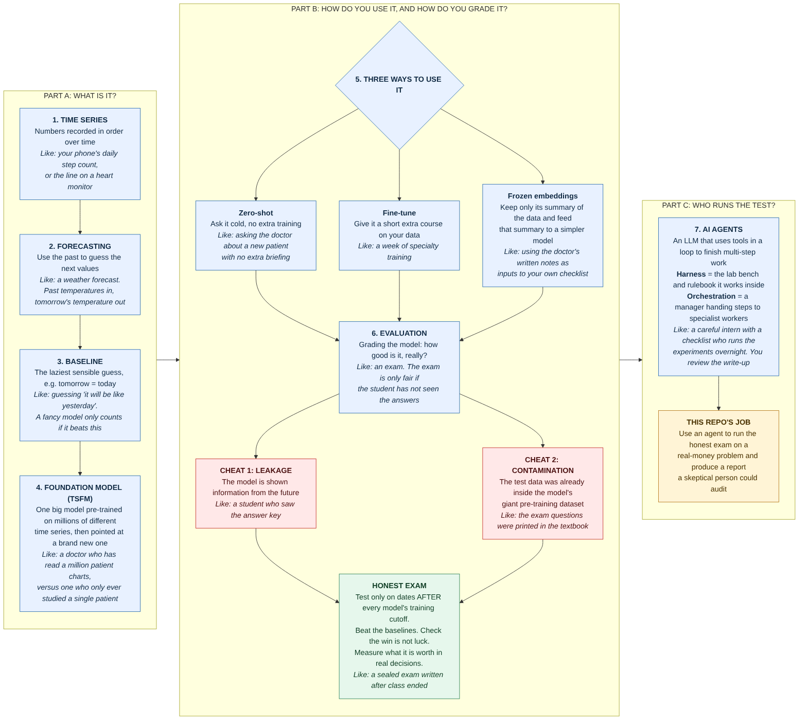

# Reserve

[](https://github.com/BK5102/reserve/actions/workflows/ci.yml)

Can a pretrained time series foundation model (TSFM) forecast how each batch of loans will go bad as it ages, including in a recession and with thin history, better than the classical methods lenders use, and are its uncertainty ranges honest?

Lenders track every quarter's new loans as a group, called a vintage, the way a school tracks a graduating class: what share of the class has ever gone 90 or more days late by each month of age. Reserve forecasts the next 12 months of those curves with three classical methods and pretrained models, under an evaluation built so no model can see the future.

**Status: pipeline built and tested on synthetic data. No result exists yet.** Real data is waiting on two free registrations (see [Manual steps](#manual-steps)). Every number produced so far comes from a simulator and is a pipeline check, not a finding.

**Limits on the first screen:** the data is Freddie Mac's public sample of prime, conforming, fixed-rate US mortgages, not all consumer credit, and not any bank's own loans. The 2007 to 2009 recession is a single episode and is reported descriptively only. COVID forbearance months (2020 to 2021) are excluded from scoring.



## Quickstart (synthetic data, no registration needed)

```
uv sync
uv run pytest -q
uv run reserve prepare synthetic --config configs/synthetic_small.yaml
uv run reserve run configs/synthetic_small.yaml
uv run reserve run configs/synthetic_small.yaml --experiment thin_history   # dev only
uv run reserve run configs/synthetic_small.yaml --experiment scenarios      # HYPOTHETICAL, dev only
uv run python scripts/check_data_fit.py synthetic configs/synthetic_fit.yaml
```

The synthetic run takes about 10 seconds on a laptop CPU and prints "SYNTHETIC DATA: a pipeline check, not a result". Results go to `artifacts/runs/<run id>/results.json` with the config hash, git commit, data checksums, and package versions.

## Manual steps

Two free accounts are needed before any real number exists. Neither has been set up yet.

1. **Freddie Mac Single-Family Loan-Level Dataset.** Register and sign in to Freddie Mac's Clarity Data Intelligence (linked as "Access Historical Data" on the [dataset page](https://www.freddiemac.com/research/datasets/sf-loanlevel-dataset)), open the Data Download section, and download the sample files `sample_YYYY.zip` for every year. Unzip them into `data/raw/freddie/` so it holds `sample_orig_YYYY.txt` and `sample_perf_YYYY.txt` pairs. Use of the data is subject to Freddie Mac's dataset terms; the files are never committed (`data/raw/` is gitignored).
2. **FRED API key.** Request a free key from the St. Louis Fed ([FRED API keys](https://fred.stlouisfed.org/docs/api/api_key.html)) and put it in the environment variable `FRED_API_KEY`, never in a file in the repo:
   - PowerShell: `$env:FRED_API_KEY = "your-key"`
   - bash: `export FRED_API_KEY=your-key`

Then:

```
uv run reserve prepare macro                      # every ALFRED vintage of the 3 series -> data/raw/fred
uv run python scripts/check_data_fit.py freddie data/raw/freddie --fred data/raw/fred --out artifacts/data_fit_freddie.json
uv run reserve prepare freddie --config configs/freddie_sample.yaml
uv run reserve run configs/freddie_sample.yaml    # development period only
```

Record the data-fit numbers in `docs/data-fit.md` (the gate: at least 60 usable vintages and 20 events per vintage by age 12) before anything else. The test period (2013 to 2018 origins) is scored only after `uv run reserve seal configs/freddie_sample.yaml`, committing the lock, and setting `evaluation.period: test`.

For the agent: `uv sync --extra agent`, set `ANTHROPIC_API_KEY` in the environment (never in a file), then `uv run reserve agent "do TSFMs help when history is only 12 months?"`. Add `--record cassettes/name.json` to save the conversation for replay. It has not been run live yet.

For the Chronos-Bolt-tiny adapter: `uv sync --extra tsfm` (CPU-only PyTorch) and add `chronos_bolt_tiny` to the config's `tsfm` list. `uv run reserve run configs/synthetic_tsfm.yaml` runs it on the synthetic portfolio (a pipeline check); its verified settings and CPU cost are in `docs/tsfm-notes.md`.

## What is built

| Piece | Where | Tested how |
|---|---|---|
| Freddie Mac loader, layout from Freddie Mac's own header files (Release 47 and later), legacy layout detected | `src/reserve/data/loans.py` | Hand-built fake records in the exact layout; field list compared with the official header text |
| Vintage curves: cumulative share ever 90+ days late or defaulted, by original loan count | `src/reserve/data/vintages.py` | Hand-computed values, a brute-force recount, reconciliation on every build, past-only cutoffs |
| Macro series (unemployment, 30-year mortgage rate, FHFA house prices) as known at the time, from ALFRED | `src/reserve/data/macro.py` | Fake FRED cassette; leak test deleting and corrupting later releases |
| Synthetic portfolio with known answers (tests only) | `src/reserve/data/synthetic.py` | The pipeline recovers every simulated event exactly |
| Data-fit check | `scripts/check_data_fit.py` | Synthetic run; real numbers pending |
| Contestants: A last pace persists, B average age curve, C hazard regression on age and past-only macro, D TSFM (Chronos-Bolt-tiny real, behind the `tsfm` extra) | `src/reserve/models/` | Values by hand, known coefficients recovered, corrupted-future leak tests; Chronos-Bolt checked against the real model when the extra is installed |
| Rolling origins and scores from the shared Cleanroom (splits, quantile losses, coverage, Diebold-Mariano, Holm, sealed runs) | `src/reserve/evaluation/` | Hand-computed scores; sealed-run guard refuses a missing or changed lock |
| Thin-history experiment: the portfolio is 6, 12, or 24 months old, same targets at every level, dev only | `src/reserve/evaluation/experiments.py` | A spy contestant sees no older vintage; corrupted-future leak test; Holm across levels |
| HYPOTHETICAL macro scenarios (baseline, adverse, severe) for contestant C, never scored, dev only | `src/reserve/stress/scenarios.py` | Paths by hand; baseline equals the flat path; leak test on later macro releases |
| Drift monitor: 90% coverage, loss ratio against a backtest window, macro range; `reserve monitor` | `src/reserve/monitoring/drift.py` | Planted synthetic drift turns red within the window; thresholds by hand |
| Agent: four-tool allow-list, runner, two-stage critic, evidence-pack reporter; `reserve agent` | `src/reserve/agent/` | Hand-written cassettes (no API calls): denials, the test-period lock, typed numbers, claim directions, objection pointers |

The testing toolkit is the shared [Cleanroom](https://github.com/BK5102/tells/tree/main/packages/cleanroom), installed from the Tells repo at tag `cleanroom-v0.2`.

## How the exam stays honest

- Every forecast at month t uses only data known at t: curve cells up to t, and macro values as published by the end of t (ALFRED vintages). A test corrupts everything after t and checks that no forecast changes.
- Forecast origins are Cleanroom splits; the development window ends a full horizon before the test window starts, so no development outcome is a test answer.
- The test period is scored only under a committed lock for that exact config and data, and every attempt is counted.
- Every TSFM must beat the best classical baseline, picked after the fact, with a Diebold-Mariano test and Holm's correction for the number of comparisons.
- Negative results stay in. Synthetic data never appears in findings.

## Docs

- `docs/methodology.md`: every choice, why, what else was considered, its limitation, and the limitations register.
- `docs/explain-the-project.md`: the project step by step, with a sentence to say for each step.
- `docs/decisions.md`: the dated diary.
- `docs/data-fit.md`: can the data answer the question (real numbers pending).
- `docs/tsfm-notes.md`: what each TSFM's documentation says, and what is unverified.
- `docs/findings.md`: results (none yet).
- `PLAN.md`: diagrams, glossary, requirements, and the 30-day plan.

## Not built yet

Real runs of the second and third TSFMs (Chronos-2 and TimesFM 2.5 are stubs), TSFMs with macro covariates, the ensemble contestant, calibration plots, the toy reserve translation, slice analysis, and any live agent run (PLAN.md Part 6).

## Related projects

Part of a three-project series that shares one evaluation toolkit, the Cleanroom:

- [Tells](https://github.com/BK5102/tells): does a time series foundation model help a bank-style fraud model at a fixed daily review budget? Home of the [Cleanroom](https://github.com/BK5102/tells/tree/main/packages/cleanroom).
- [Reserve](https://github.com/BK5102/reserve): do foundation models forecast mortgage delinquency curves better than classical methods?
- [Culprit](https://github.com/BK5102/culprit): do foundation models catch payment approval drops sooner, and can an LLM agent find the cause?
